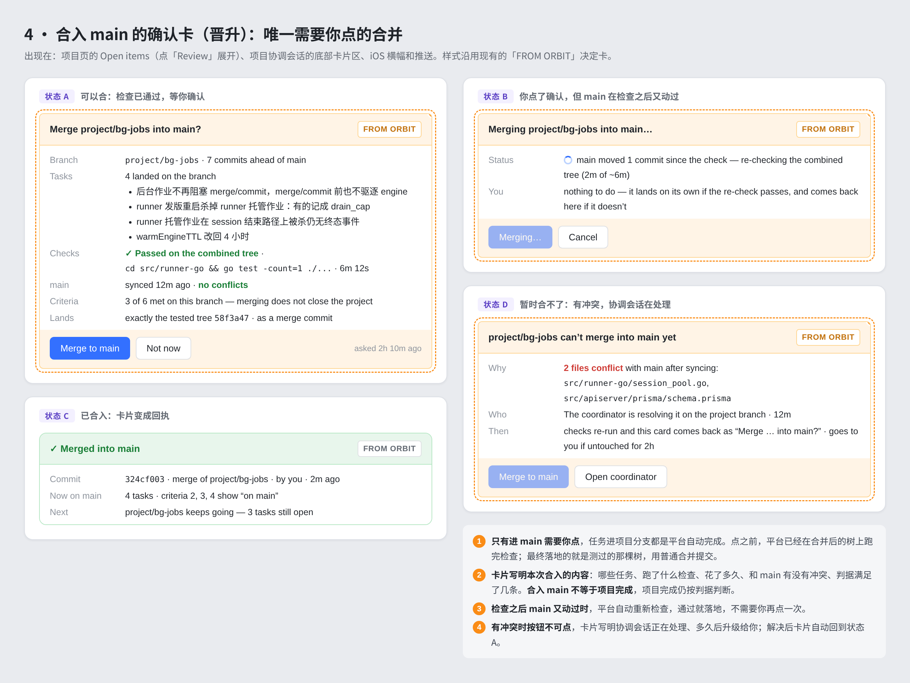

<h1 align="center">Orbit — Agent Mission Control</h1>

<p align="center"><strong>Self-hosted mission control for coding agents</strong></p>

<p align="center">
  Run coding agents on your own machines. Keep the plan, history, and controls in one self-hosted place.
</p>

<p align="center">
  <a href="https://github.com/jianghailong-xy/orbit/releases"></a>
  <a href="LICENSE"></a>
  <a href="https://github.com/jianghailong-xy/orbit/actions/workflows/client.yml"></a>
</p>

<p align="center">
  <a href="#quick-start">Quick Start</a> ·
  <a href="docs/90-second-demo.md">90-second demo</a> ·
  <a href="docs/README.md">Docs</a> ·
  <a href="docs/self-hosting.md">Self-hosting</a> ·
  <a href="SECURITY.md">Security</a> ·
  <a href="CHANGELOG.md">Changelog</a>
</p>

Orbit is for small engineering and infrastructure teams already running coding agents against private code or
internal systems; individual power users coordinating several agent sessions across machines are a good secondary
audience. It keeps work visible and resumable across sessions, machines, and context windows, while execution
stays on machines you choose.

> [!NOTE]
> Orbit is self-hosted: you operate the server, register runners, install and authenticate an agent runtime, and
> choose the access controls, TLS, backups, and host hardening. It is not a managed SaaS, a no-setup autonomous
> coding service, or a security sandbox.

## Three launch scenarios

The names and order follow the [launch messaging brief](docs/messaging-brief.md).

**1. Work that outlives a chat.** Turn a multi-day migration, refactor, or test rescue into a durable task graph.
Dependencies, comments, and session history survive context limits, restarts, and a closed browser, so the next
session continues without reconstructing the plan.

**2. Parallel agents without checkout collisions.** Split a backlog across runners with a separate git worktree
per session. Agents work concurrently; you review the diffs and choose what to merge. A worktree prevents file
collisions, but it is not a security boundary.

**3. Access to private infrastructure.** Put a runner on a machine that already has the repository, internal CLI,
VPN, or cluster access. Runners poll outward, and a risky command can appear as an approval card before it
proceeds. The runner account still has the OS access you grant it.

[](docs/90-second-demo.md)

*An annotated UI preview from the repository's design evidence, not a hosted-service guarantee. The narrated
walkthrough is the [90-second demo](docs/90-second-demo.md).*

## Quick Start

From a fresh Linux host to an online runner and a first task. Keep the server and runner on a private network
until HTTPS and host controls are in place — see the [hardening guide](docs/self-hosting.md) and
[security policy](SECURITY.md).

### 1. Start the control plane

Requires Docker Engine with the Compose plugin, Git, and OpenSSL (no Node or Go).

```bash
git clone https://github.com/jianghailong-xy/orbit.git
cd orbit
# Recommended: pin a reviewed release tag (the package version with a v prefix)
# git checkout vX.Y.Z
scripts/install-server.sh
docker compose ps
```

Open <http://localhost:2086>. The first visitor is redirected to `/setup` and becomes the administrator.

<details>
<summary>What the install script does, and options</summary>

- Writes `.env` with independently generated secrets (never commit it), sets up the
  [runner link](docs/self-hosting.md#runner-link), builds the images, and starts the stack. The link needs no port
  or certificate of its own: runners reach it through the same port as the web, encrypted where that is.
- **Public origin:** for a network deployment, give the external HTTPS origin before the web image is built:
  `scripts/install-server.sh --public-origin https://orbit.example.com` (or `PUBLIC_ORIGIN` in `.env`).
- **Managed runners** ([Orbit Cloud](docs/self-hosting.md#managed-runners)) are off unless you pass
  `--managed-runners`. With them on, every account gets its own runner, a container on this host's Docker, when it
  signs in. Read who gets one and how far a container isolates it before you open sign-up.
- **Source archives:** the build stamps the downloadable runner with the checkout's commit. Without Git metadata,
  name it explicitly: `ORBIT_SOURCE_SHA=<40-character commit> docker compose up -d --build`. Do not put it in
  `.env`, where it would go stale after an upgrade.
- **By hand:** write `.env` as [self-hosting](docs/self-hosting.md#1-configure-the-deployment) describes, then
  run `docker compose up -d --build`.

</details>

### 2. Add a runner

In the web UI, open **Infrastructure → Add → Register a machine**, choose Linux or macOS, and run the command it
shows **on the machine that has the repository, internal tools, VPN, and agent credentials**:

```bash
curl -fsSL http://localhost:2086/install.sh | bash
```

It downloads the static runner, runs `orbit register`, and opens (or prints) a browser approval URL. Approve the
machine; the UI shows **Runner online** after the first heartbeat. Then check the runner:

```bash
orbit status
orbit doctor   # is Claude Code, Codex, Kimi Code, or OpenCode installed and signed in?
```

Install and authenticate at least one supported runtime on the runner; Orbit does not move engine credentials to
the control plane. With managed runners on, each account already has a runner, which takes sessions once a runtime
is signed in on it — register your own machine when the work needs its repositories, network, or credentials.

<details>
<summary>Non-interactive registration</summary>

While signed in, create a one-time enrollment token with `POST /api/runners/enrollment-tokens` (the web UI has no
button for it, and a personal access token is refused) and pass it to `orbit register --token`. Never put a
long-lived runner token in source control.

</details>

### 3. Run a first task

Choose **Create a workspace**, select the runner, and point it at a Git checkout — or copy the tiny
[demo repo](examples/demo-repo/) into a standalone repository if you'd rather not use a private project. Create a
task such as “run the tests and explain the result”, assign it to the workspace, and start it. The task graph,
transcript, approvals, and result stay in Orbit even if you close the browser.

Next: upgrades, backups, TLS, and troubleshooting are in [Self-hosting](docs/self-hosting.md). The
[clean-host install record](docs/evidence/clean-install-2026-09-29.md) shows a dated, sanitized run of this path —
exact commit, tool versions, elapsed time, and where provider availability blocked the first real task.

## What Orbit provides

| Need | Orbit's answer |
| --- | --- |
| Work that outlives a chat | Durable projects, task lists, dependencies, comments, resumable sessions, and searchable history |
| Parallel work | Optional per-session git worktrees, diff review, and an explicit human merge decision |
| Private infrastructure | Outbound-polling runners beside the repositories, CLIs, credentials, VPNs, and internal networks you choose to expose |
| Human control | Permission modes, live approval cards, status, usage, and the ability to interrupt or redirect a run |
| Several runtimes | Claude Code, Codex, Kimi Code, and OpenCode, plus configured compatible providers |
| Several screens | Responsive web UI plus native macOS and iPhone/iPad clients |

Orbit coordinates and supervises agents; it does not guarantee that an agent finishes correctly without review,
approval, or a human merge decision.

## Architecture and security

```text
Web / macOS / iOS ── REST + SSE ──▶ Control plane + PostgreSQL ◀── outbound poll ── Runner
   tasks · history · approvals          queue · audit · usage                local agent runtime
                                                                              optional git worktree
```

- **Control plane:** NestJS, Prisma, and PostgreSQL own users, workspaces, sessions, projects, tasks, approvals,
  runners, attachments, and usage.
- **Runner:** a small static Go CLI registers a machine, claims work, drives the selected local runtime, and
  reports heartbeats, transcripts, approvals, and outcomes.
- **Clients and gateway:** Vite/React web plus shared SwiftUI clients; nginx serves the web and `/api` from one
  origin in the Compose deployment.

Runners connect outward; the control plane needs no inbound access to a runner. That is a network topology, not a
sandbox: agent processes inherit the runner OS account's permissions. Use least-privilege accounts, unique
secrets, HTTPS before network exposure, off-host backups, and a tested restore. Read
[Architecture](docs/architecture.md), [Security](SECURITY.md), [Self-hosting hardening](docs/self-hosting.md), and
[HUMAN_ONLY authority](docs/human-only-authority.md) before attaching sensitive infrastructure.

## FAQ

<details>
<summary><strong>Is Orbit hosted for me?</strong></summary>

No. You run the control plane and PostgreSQL and decide where they are reachable. The included Compose gateway is
HTTP-only and a starting point; put TLS and access controls in front of it before exposing it to a network.

</details>

<details>
<summary><strong>Do my model or engine credentials leave the runner?</strong></summary>

The supported coding-agent CLIs use the runner's local configuration and credentials. The control plane stores the
metadata and transcripts needed for coordination; provider behavior and billing remain the provider's
responsibility. A self-hosted Codex pool is a separate control-plane feature documented in
[Self-hosting](docs/self-hosting.md).

</details>

<details>
<summary><strong>Is a worktree a security sandbox?</strong></summary>

No. It reduces checkout collisions between concurrent sessions. Processes still run as the runner OS account and
can reach whatever that account can. Use a separate least-privilege host or account when the trust boundary
requires it.

</details>

<details>
<summary><strong>What happens if the runner or browser goes away?</strong></summary>

The task graph and session history live in the control plane. A runner that stops sending heartbeats is treated as
offline, and other eligible runners can continue queued work. Resume behavior, model features, and usage data vary
by engine and provider, so verify the behavior you need before relying on it.

</details>

<details>
<summary><strong>Which agent runtimes are supported?</strong></summary>

Claude Code, Codex, Kimi Code, and OpenCode. The runtime must be installed and authenticated on the runner;
`orbit doctor` is the first diagnostic. Feature parity across engines is not promised.

</details>

<details>
<summary><strong>Can I run the server without Docker?</strong></summary>

For development, yes — see [Develop locally](#develop-locally). The documented operator path is Docker Compose
because it keeps the gateway, API, PostgreSQL, and backup sidecar together.

</details>

## Project status and releases

Orbit is a **pre-1.0 open-source project under active development**. Pin deployments to a tagged release and
review upgrade notes before changing versions. The latest published release receives best-effort security fixes;
`main` is a development branch and older releases are not supported.

Core functionality is in place: distributed runners, interactive sessions, project coordination, task graphs,
approvals, worktree isolation, multi-runtime support, web and native clients, runner recovery, backups, and usage
reporting. Recurring schedules and inbound task sources (ticket/chat ingestion) are designed for but not yet built.

- **One version:** the root `package.json` version is the version of record, and a release tag is that version
  with a `v` prefix. The GitHub Release, macOS DMG, TestFlight build, Android APK, runner binaries, and update feeds
  all derive from it ([Release process](docs/release-process.md); check a tag with
  `node scripts/release-identity.mjs check-tag <tag>`). Tags published before this rule do not share the package
  version; treat them as history, not as a pattern.
- **Verifiable artifacts:** every release publishes `SHA256SUMS`, a CycloneDX SBOM, an in-toto/SLSA provenance
  statement, and a GitHub artifact attestation — see [Verifiable release supply chain](docs/supply-chain.md).
- **What changed:** the [curated changelog](CHANGELOG.md) and each tag's notes on the
  [Releases page](https://github.com/jianghailong-xy/orbit/releases).
- **Where it's going:** the [public roadmap](ROADMAP.md) (adoption gates, not dates) and the
  [maturity roadmap](docs/project-maturity.md) list the evidence required before calling a release
  production-ready.

## Develop locally

Contributors need Node.js 26+, Docker or PostgreSQL 16, and Go 1.27+ when changing the runner:

```bash
npm install
cp .env.example .env
npm run db:up
npm run prisma:generate
npm run prisma:migrate -w @orbit/apiserver
npm run dev:apiserver
```

In another terminal, run `npm run dev:web`. The API is on <http://localhost:3000> and Vite on
<http://localhost:5173>. The [development guide](docs/development.md) covers tests, repository layout, and the
native clients.

## Community and support

- **Questions:** start with the [documentation index](docs/README.md) and the [support guide](SUPPORT.md), then
  [GitHub Discussions](https://github.com/jianghailong-xy/orbit/discussions). Give feedback on a release you
  upgraded to in the [release feedback discussion](https://github.com/jianghailong-xy/orbit/discussions/159).
- **Bugs and proposals:** use the [GitHub issue forms](https://github.com/jianghailong-xy/orbit/issues).
- **Security vulnerabilities:** follow [SECURITY.md](SECURITY.md); never in a public issue.
- **Contributing:** read [CONTRIBUTING.md](CONTRIBUTING.md), the [Code of Conduct](CODE_OF_CONDUCT.md), and
  [GOVERNANCE.md](GOVERNANCE.md), then pick a
  [good first issue](https://github.com/jianghailong-xy/orbit/issues?q=is%3Aissue+is%3Aopen+label%3A%22good+first+issue%22).
  The [community guide](COMMUNITY.md) has more.
- **Further reading:** [durable agent work](docs/article-durable-agent-work.md) and
  [a private multi-runtime control plane](docs/article-private-multi-runtime-control-plane.md).

Support is community-maintained and best effort — not an emergency channel, SLA, or enterprise support contract.
Sanitize logs and never post tokens, cookies, API keys, private hostnames, repository contents, or runner
configuration.

## License

[MIT](LICENSE).
