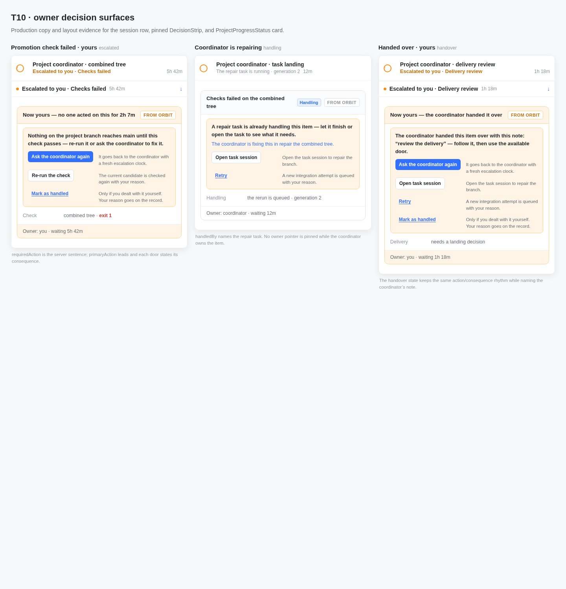
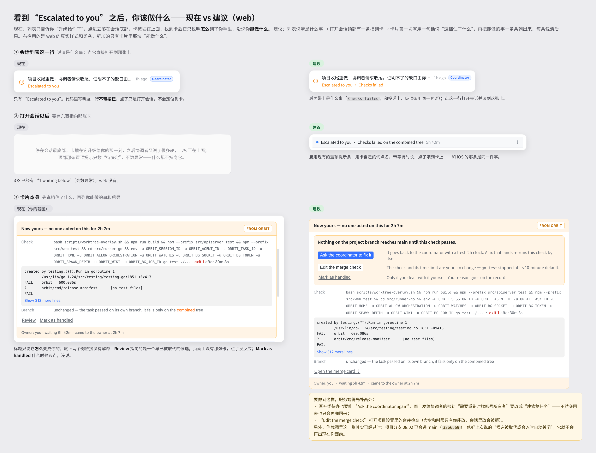
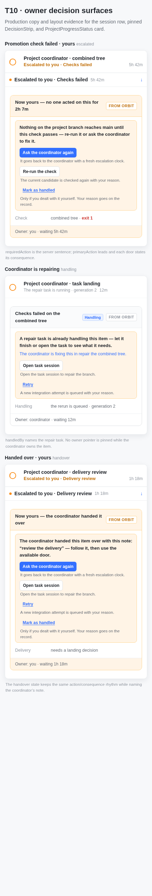

# T10 visual evidence

The fixture in [`../t10-owner-states.html`](../t10-owner-states.html) uses the production
`src/web/src/index.css` and the production card/strip class names. It covers the three requested
states (owner promotion-check failure, coordinator handling, and hand-over) at both viewport sizes.

| 1440px | reference board2 |
| --- | --- |
|  |  |

| 443px | reference board2 |
| --- | --- |
|  |  |

The first card's `requiredAction` is copied verbatim from the server projection:

> Nothing on the project branch reaches main until this check passes — re-run it or ask the coordinator to fix it.
