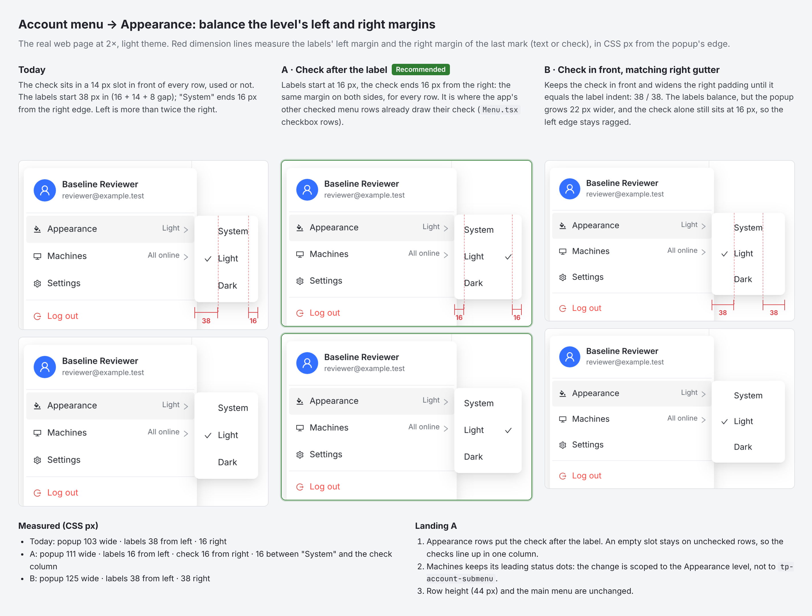
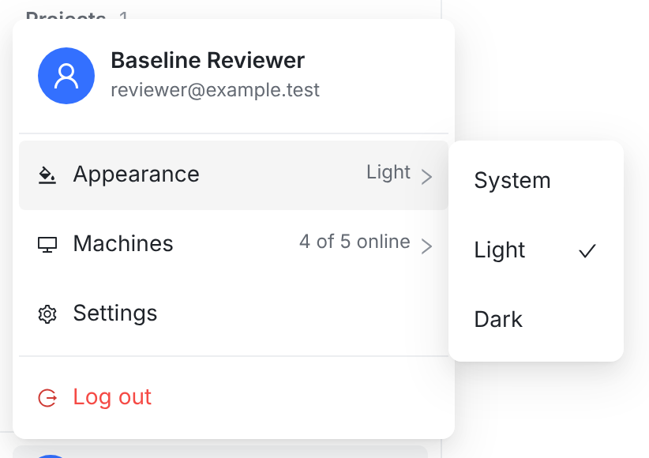
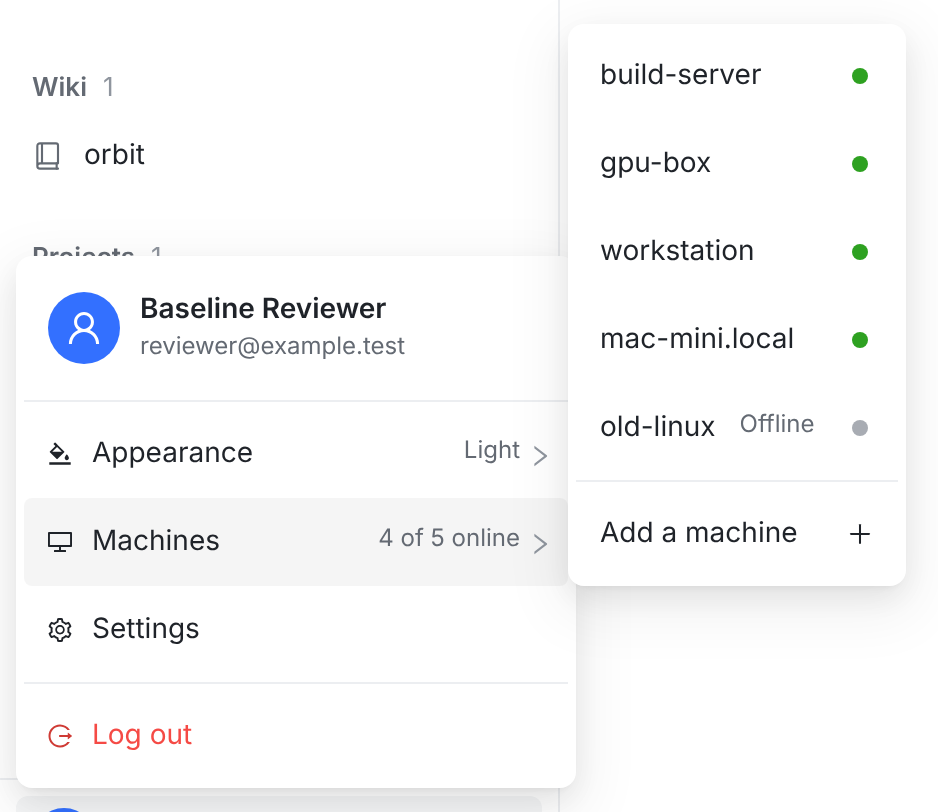

# Account menu → Appearance: balance the level's left and right margins

The Appearance level draws its check in a 14 px slot in front of every row. So its labels start 38 px from the
popup's left edge, while "System" ends 16 px from the right edge. Measured on the real page (CSS px):

| | Popup width | Labels from left | Last mark from right |
|---|---|---|---|
| Today | 103 | 38 | 16 |
| **A · check after the label (recommended)** | 111 | 16 | 16 (the check) |
| B · check in front, matching right gutter | 125 | 38 | 38 |

A is the recommendation:
- It has the same margin on both sides, for every row.
- The shared menu's own checkbox rows (`Menu.tsx`, `CheckboxItemIndicator`) already draw their check after the label.

B balances the labels, but it widens the popup and leaves the lone check at 16 px.

Landing A:
- Only the Appearance level changes. Machines keeps its leading status dots.
- Unchecked rows keep an empty slot, so the checks line up in one column.
- The 44 px rows and the main menu are unchanged.

How the shots were made:
- The real web page, built from main `55a189aa3`, at 2×, light theme, from the shared UI fixtures.
- A and B are CSS injected over that build.
- `today.png`, `a.png` and `b.png` carry the dimension lines; the `-clean` shots are the same page without them.

## Decision (2026-11-16): A, in both levels

The owner chose A, and the same for the Machines level: every icon goes after its label.

| Shipped | Appearance | Machines |
|---|---|---|
| Shot |  |  |

Measured on the shipped CSS:
- Every label starts 16 px from the popup's left edge.
- The check, each machine's status dot and Add a machine's + are centred in one column, 23 px from the right edge.
- An offline machine reads "Offline" before its grey dot.
- Every row is 44 px.
