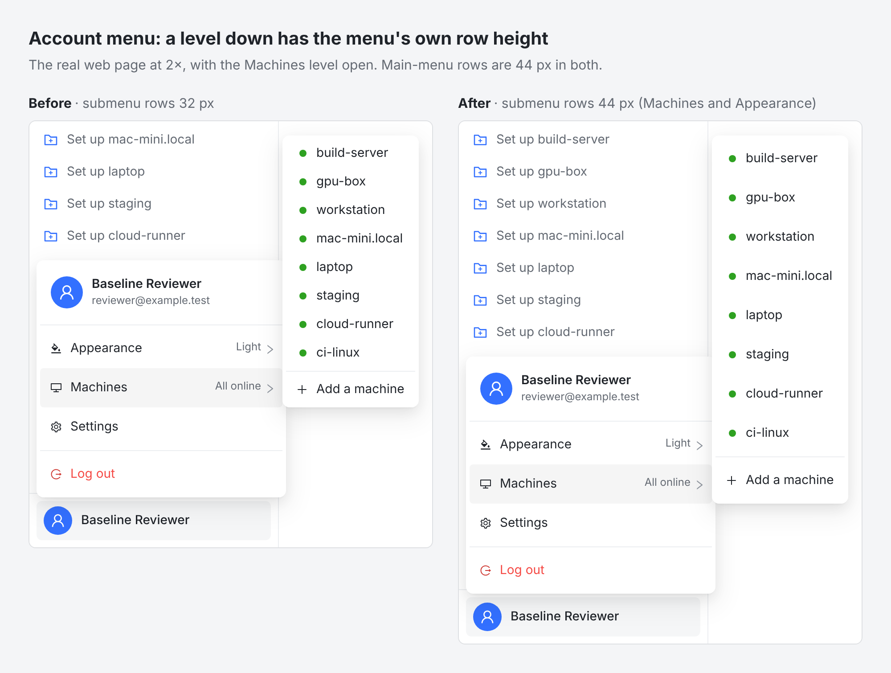

# Account menu: submenu rows as tall as the menu's own

The account menu (sidebar foot) draws its rows 44 px tall. Its levels (Appearance, Machines) drew theirs at the
shared menu's 32 px, because `popupClassName` reached only the root popup. A row with `children` now takes its
own `popupClassName` for its level (`Menu.tsx`), and the account menu gives both levels `tp-account-submenu`,
which `index.css` holds to the same 44 px.

- `after.png`: the real web page built from this branch, 2×, light theme, eight sample machines, Machines level open.
- `before.png`: the same build with the old 32 px submenu rows put back by an injected style.
- Measured rows after: main menu 64 (profile) / 44 / 44 / 44 / 44; Machines level 44 × 9.
