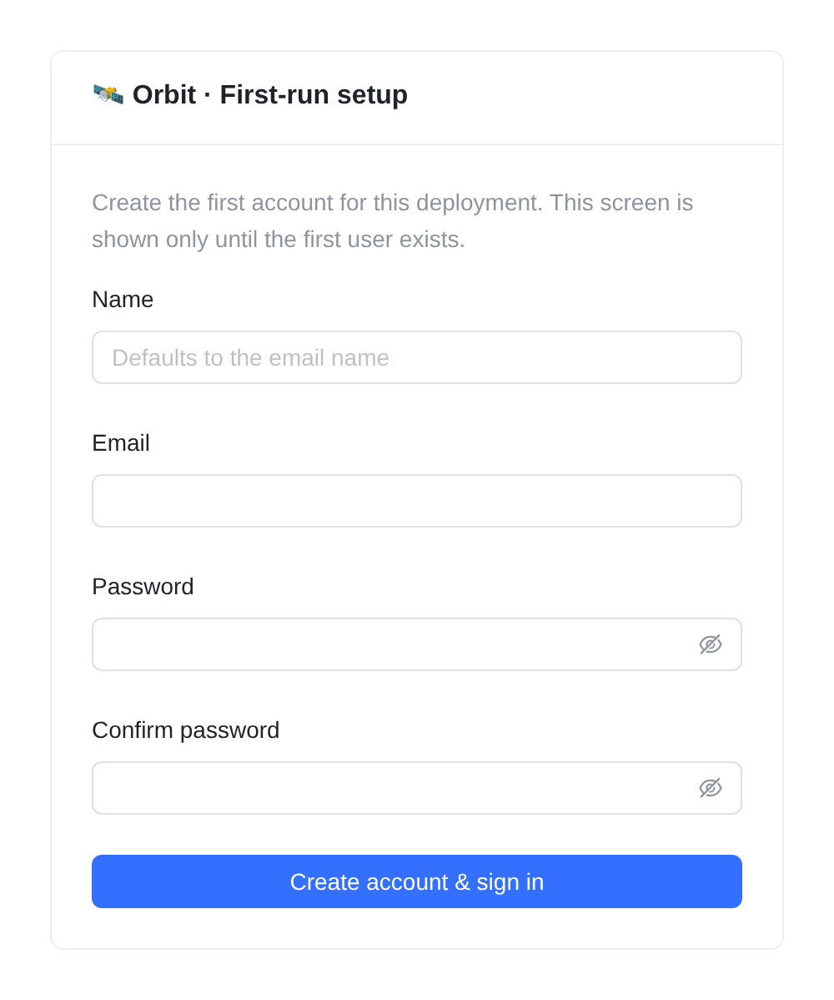
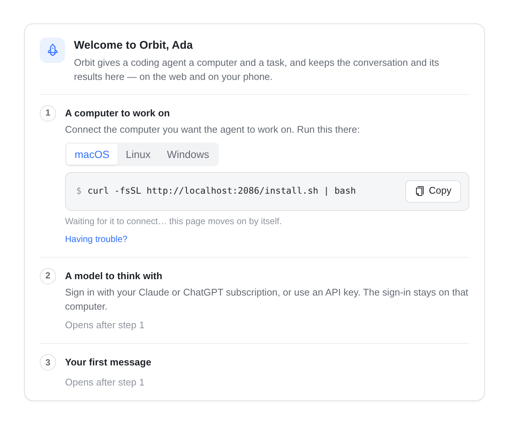
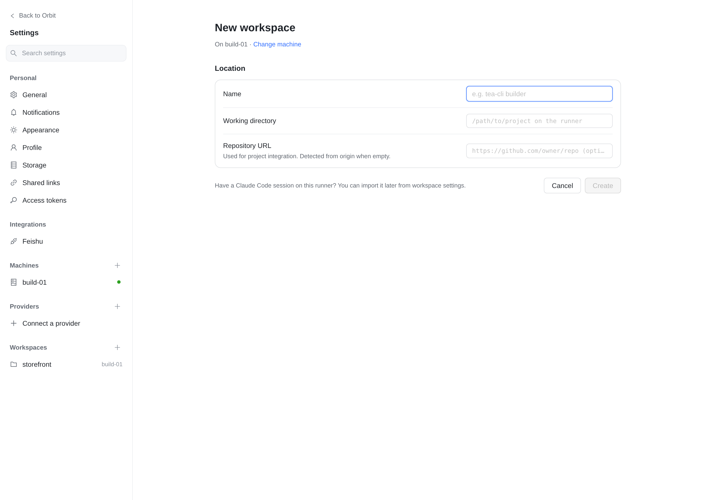
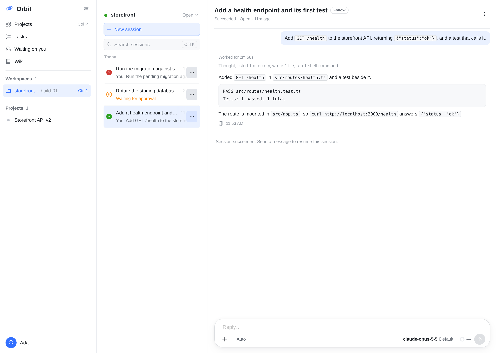
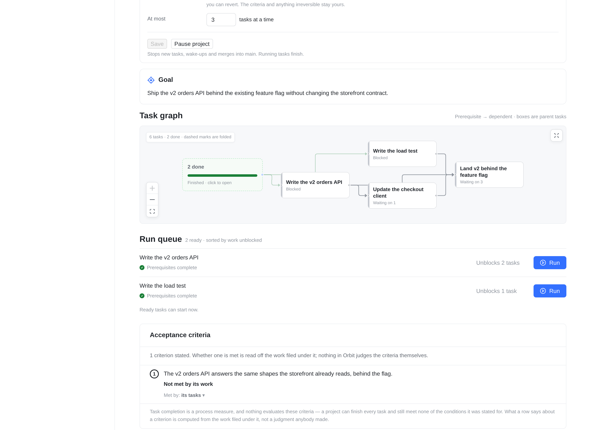
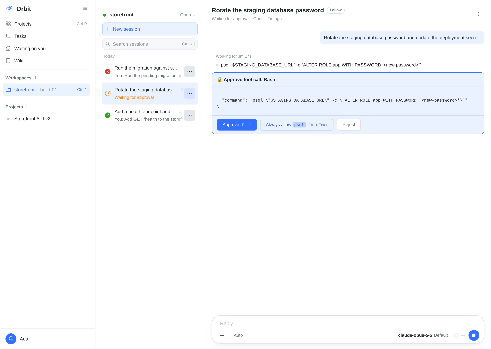
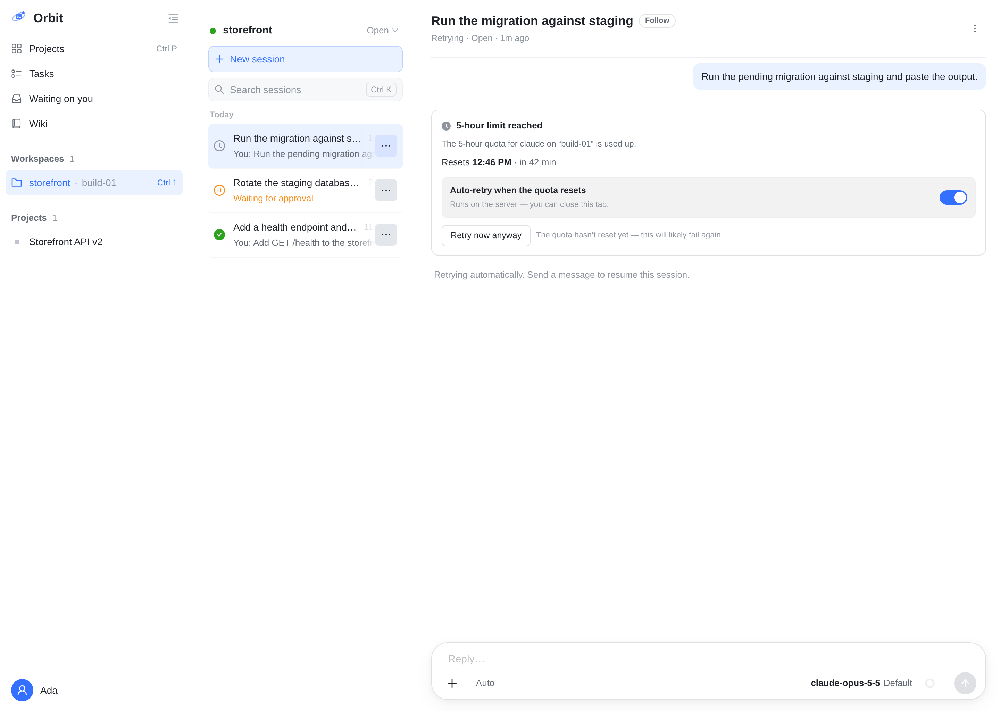

# Onboarding, step by step

This guide walks a new operator through the first seven moments of a self-hosted Orbit: the first
administrator, the first runner, the first workspace, a first session, a project's task graph, one
approval, and what recovery looks like when a run stops. Every screenshot is of the current web UI,
taken from a deployment like the one [self-hosting](self-hosting.md) describes. The data in them is a
demo team's — names, folders, and repository paths are examples, not something Orbit ships.

Use it beside the [clean-machine first-run checklist](first-run.md), which has the exact commands and
an evidence table to fill in. This page says what you are looking at and what each screen decides.
The [current clean-host record](evidence/clean-install-2026-11-14.md) records the isolated deployment,
Runner heartbeat and first completed Task, including the checks and limitations of that run.

## 1. Create the first administrator

Open the deployment's origin in a browser. Until an account exists, every path redirects to `/setup`:

This is trust on first use: the first visitor creates the account, and that account is the
administrator. There is no public sign-up afterwards; administrators create the other accounts under
**Admin → Users**, or enable Google sign-in under **Admin → Sign-in**.

- The **name** is optional; it defaults to the part of the email before `@`.
- The password must be at least six characters. Choose a real one — this account can read everything.
- **Create account & sign in** also signs you in, and takes you straight to the runner guide in the
  next step.

If `/setup` shows **Sign in** instead, the deployment already has users: someone finished this step.
`GET /api/auth/setup-status` answers `needsSetup: false` in that case. To see every prerequisite
around this screen, read [first-run, steps 1–3](first-run.md#3-build-boot-and-create-the-first-administrator).

## 2. Connect the first runner

A runner is the machine that actually runs coding agents. Until one is online, Orbit has nowhere to
execute anything, so the first screen after setup is a three-step welcome card:

- **A computer to work on.** Pick the operating system and run the shown command on that machine.
  The command downloads `install.sh` from this deployment, installs the `orbit` CLI, and opens a
  browser page to approve the machine's enrollment. Keep the terminal open until it says the service
  is installed; the installer creates a systemd unit on Linux or a launchd service on macOS.
- The card **moves on by itself** once the machine's handshake completes. Refreshing is not needed.
- **A model to think with.** Once the machine is online, this step offers the sign-in command for the
  runtime you will use (Claude Code, Codex, Kimi, OpenCode, DeepSeek Harness, Cursor, Antigravity).
  The credential stays on that machine; the control plane never receives it.
- **Your first message** opens after the runtime is signed in.

If the page does not move on, the same steps with checks for each failure are in
[runner troubleshooting](runner-troubleshooting.md). A managed runner is the alternative: with managed
runners on, the administrator already has one at sign-in, and there is nothing to install
([Managed runners](self-hosting.md#managed-runners)).

## 3. Create the first workspace

A workspace is a **folder on one machine** — the directory an agent works in. Open **Settings →
Workspaces → New workspace**, choose the machine, then fill the form:

- **Name** is the label the console and the session lists use. It can be anything short.
- **Working directory** is an absolute path on the runner. It must exist and be writable by the
  runner's OS account. Tasks run with that account's privileges — see
  [the trust boundary](architecture.md).
- **Repository URL** is optional. Orbit detects the repository from the folder's `origin` remote when
  it is left empty, and only uses it for project integration.
- **Create** saves the workspace and opens its settings page. The first session starts from the
  workspace's own screen, not from here.

The machine has to be online to create a workspace on it. When there is no machine yet, the page
offers **Register a machine** instead — the previous step.

## 4. Start a session and watch a turn

Open the workspace from the sidebar and press **New session**. Describe the first task in the
composer and send it: the session runs on that workspace's runner, and its transcript is the record —
the messages, the tool calls the agent made, and their results:

What to notice:

- The composer shows the **engine and model** the session runs on — here `claude-opus-5-5` — and the
  effort next to it. Both can be changed per session before sending.
- **Worked for …** is the turn's summary line; under it, the collapsed thinking and the tool calls.
  Expanding a tool row shows its exact input and output.
- A finished turn parks the session at **AWAITING_INPUT**, not at a closed state: send another message
  and it continues with its context. The sidebar keeps the session under **Open** until you complete
  or trash it.
- The session list groups by status: **Open**, **Completed**, **Trash**, and the per-workspace badge
  counts what needs you.

Permission mode matters here: on a runtime that can ask (Claude Code and Kimi), `Auto` lets the
agent's own tool calls run inside the workspace and `Default` asks you first — which is the next
step. A runtime that cannot put a person in the loop says so on the mode picker and either refuses
unapproved actions or runs them; the picker's note is the session's real answer.

## 5. Organize work as a project and read its task graph

A project is a goal with a body of work under it. Create one under **Projects → New project**, add
tasks, and say which task waits for which. The project page then draws the graph:

- **Work overview** counts the project in the states that matter: running, ready, waiting on
  dependencies, awaiting verification, done, failed, cancelled.
- **Task graph** is the dependency picture. Arrows point from a prerequisite to the work waiting on
  it; a dashed box is several finished tasks folded together, which can be opened. The graph is the
  whole project — it does not page.
- **Run queue** is the actionable half: tasks whose prerequisites are complete, with how much work
  each one unblocks. **Run** starts one on its assigned workspace.
- **Acceptance criteria** state what would settle the project. Each task also carries its own
  criterion — how its completion will be proved — which is what the run and its verification read.

A project's tasks can also be executed by its coordinator — the conversation that decides what runs
next, with Automatic on — which the [project contract](project-agent-contract.md) describes.

## 6. Answer an approval

In the default permission mode, a tool call that needs a person's answer pauses the turn and shows a
card instead of running:

- The card names the tool and prints the exact input, so you can read the command before it runs.
- **Approve** (Enter) allows this one call and resumes the turn. **Reject** refuses it and tells the
  agent, which can then try another way.
- **Always allow `psql`** writes a permission rule for the workspace, so later calls of that kind do
  not ask again. It is scoped to the command prefix shown, and it is listed under the workspace's
  settings.
- Approvals are queued: the oldest answerable card owns Enter, and deciding one moves the shortcut to
  the next.
- If the turn has ended, the card says so and its actions are disabled — answering a question nobody
  is listening for reaches nobody. Send a new message instead.

Approvals are how the owner keeps a boundary in a workflow that otherwise runs unattended. The exact
rules for which calls ask, and which can be pre-approved, are in
[the interactive runner contract](interactive-claude-runner-design.md).

## 7. Recovery: when a run stops

A run that cannot continue is not a lost session. Orbit records why, keeps the conversation, and
often resumes by itself:

- **A spent quota or a provider outage** produces the card above. The turn failed, the session did
  not: **Auto-retry when the quota resets** is armed on the server, so you can close the tab and the
  run resumes without you. **Retry now anyway** is there when you know the limit has lifted.
- **A stopped runner** is recovered on its own: work it held is re-dispatched when the machine comes
  back or a sibling finishes, and the machine's page says what it is doing. If a machine stays
  offline, [runner troubleshooting](runner-troubleshooting.md) lists what to check on it.
- **A session you deleted** stays in **Trash** for 30 days; select it there and **Restore** brings it
  back to Open. A page containing a file that evidence cites can stay longer.
- **The database itself** is recovered from the backup sidecar: base backups plus archived WAL are
  restored with [the backup and restore runbook](postgres-backup-restore.md). Treat this as the last
  resort, and test the procedure before you need it. A restore goes PostgreSQL first, then the
  attachment files, then the API.

## What to read next

| You want to… | Read |
| --- | --- |
| Repeat this on a fresh host with commands and a check-off list | [Clean-machine first-run checklist](first-run.md) |
| Look up any deployment value, port, storage path, or retention rule | [Configuration reference](configuration.md) |
| Automate the same work from a script or CI | [External HTTP API reference](api-reference.md) and [Runner CLI](runner-cli.md) |
| Diagnose an enrollment, heartbeat, or sign-in failure | [Runner troubleshooting](runner-troubleshooting.md) |
| Understand what isolates what | [Architecture overview](architecture.md) |
| Back up, restore, or move the deployment | [PostgreSQL backup and restore](postgres-backup-restore.md) |

## Keeping these screenshots current

The images live in `docs/images/onboarding/` and are part of the public documentation. When a change
alters one of these screens — its copy, its layout, or the flow around it — replace the matching
image in the same pull request, so the guide a new operator reads is the UI they will meet. A stale
screenshot is worse than none: it teaches a step that no longer exists.
